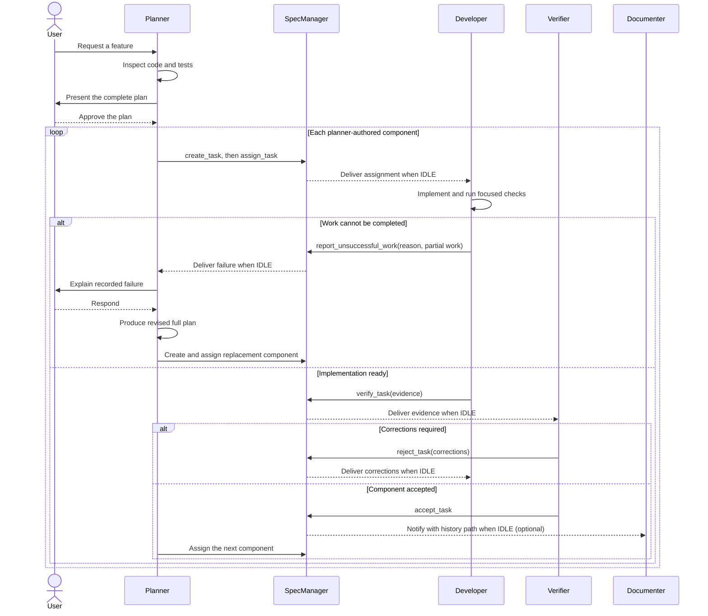

# SpecManager component workflow

Use this workflow to run a user-approved plan as sequential, independently
verified components. It is for users and contributors operating the repository
example. The `spec_manager` package is local to `example/`; it is deliberately
not exported by the reusable `pairo` package.

## Prerequisites

- Configure one planner as the director and at least one distinct
  developer/verifier pair in the agent mapping.
- Call `install_spec_manager(...)`, start the returned manager before
  `run_agents(...)`, and close it during shutdown. The verified integration is
  in [`main.py`](main.py).
- Optionally register a separate documenter. A documenter cannot also hold a
  planner, developer, or verifier role.

The installer adds the `spec_manager` MCP server, role skill, and role-specific
instructions to each planner, developer, and verifier. It does not configure
the optional documenter with those capabilities.

## Component lifecycle

The diagram answers: **who owns each decision, and when can the next component
start?**

The planner creates tasks only after the user approves the complete plan. Each
task has stable acceptance-criterion IDs such as `AC1` and `AC2`. The developer
implements only the assigned component, runs focused verification, and calls
`verify_task`. The verifier either accepts it or returns all structured
corrections. The planner assigns the next component only after acceptance; a
final integration component owns the full-suite checks.

`verify_task` evidence includes an implementation summary, changed files, one
evidence record per acceptance criterion, summarized test runs, correction
resolutions when applicable, and remaining risks. Test output should be
summarized rather than pasted verbatim.

## Unsuccessful work and replanning

If a developer cannot complete an active working component, it stops safely,
does no further speculative implementation, and calls
`report_unsuccessful_work` with a nonblank blocker reason (up to 2,000
characters) and optional partial-work context (up to 4,000 characters). Only
the registered worker can report its active `working` component; reporting is
rejected once verification has started. SpecManager persists the immutable
`unsuccessful` task outcome, releases the worker/verifier pair, resolves task
waiters, then notifies the planner when idle.

`wait_for_task` returns the terminal result as
`{"task_name": "...", "status": "unsuccessful", "reason": "...", "partial_work": ...}`.
The legacy `sleep_on_task` returns an unambiguous unsuccessful message instead
of reporting acceptance. A planner-notification timeout does not roll back the
persisted outcome or reclaim the released pair.

The planner clearly explains the recorded failure to the user and waits for
their response. It then produces a revised full plan, preserves the failed
record, creates replacement component tasks, and assigns them sequentially.
This is distinct from verifier rejection, which keeps the component active for
worker correction and resubmission.

## Handoffs and persisted records

Every SpecManager-originated assignment, verification request, correction,
unsuccessful-work planner notification, and documenter notice waits until its
recipient is idle and is delivered once. Delivery has bounded timeout and
shutdown behavior; a failed assignment is returned to pending rather than
silently remaining active.

Records live under the `folder` passed to `install_spec_manager`. The current
example passes `Path("./tmp")`, so tasks are stored in `tmp/FEATURES.md` as
structured `pairo-task` blocks and accepted evidence is appended to
`tmp/output/FEATURE_HISTORY.md`. Existing structured task files remain
compatible; unsuccessful records remain in `FEATURES.md` with their reason and
partial-work context. The former unstructured format is not supported.
