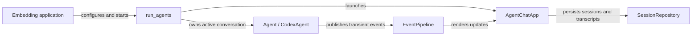

# Pairo documentation

This documentation is for developers who configure, embed, or contribute to
Pairo Loops. It answers where to start and which page owns each kind of
project guidance.

## Choose a page

| If you need to know... | Read... |
| --- | --- |
| How do I install Pairo and launch a minimal agent UI? | The repository [README](../../README.md) |
| Which component owns agents, events, and durable sessions? | [System overview](#system-overview) |
| What methods, lifecycle rules, and constraints are supported? | [Feature reference](feature-reference.md) |
| How does the Codex provider map SDK activity and approvals? | [CodexAgent architecture](codex-agent.md) |
| Which checks must contributors run, and what does the invariant checker enforce? | [Quality gate](quality-gates.md) |

## System overview

The diagram answers: **which core component owns runtime state, transient
events, and durable session data?**

`run_agents` creates initial sessions, persists their metadata, launches the
Textual UI, and closes agents and the repository on exit. Each agent owns only
its active provider session. `EventPipeline` broadcasts in-process events but
does not retain or replay them; the repository is the durable session and
transcript boundary.

Optional utilities and integrations, including `ConversationEventLog`,
`WorkspaceFactory`, chatrooms, external MCP server installers, and
`SpecManager`, build on this core architecture. They are cataloged separately
in the [feature reference](feature-reference.md#optional-tools-and-integrations).

For exact method contracts and lifecycle constraints, continue to the
[feature reference](feature-reference.md).
