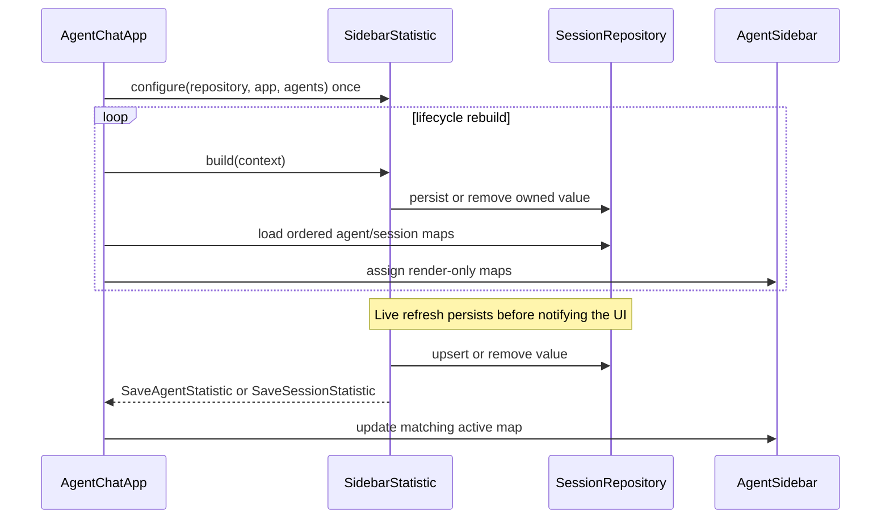

# Pairo feature reference

## Core components

| Component | Responsibility |
| --- | --- |
| `AgentConfiguration` | Validated identity, model, sandbox, instructions, MCP, skills, hooks, and approvals |
| `Agent[IdentifierT]` | Async provider-neutral conversation contract with one active session |
| `CodexAgent` | Async Codex SDK mapping, notification consumption, and approval routing |
| `FakeAgent` | Deterministic asyncio-only implementation for tests and examples |
| `EventPipeline` | Principal-loop transient broadcasting through independent buffered subscriptions |
| `SynchronousEventPipeline` | Cross-thread publication and blocking coroutine submission for synchronous SDK callbacks |
| `AgentEventListeners` | Typed, optionally agent-filtered subscriptions for agent and session events |
| `SessionRepository` | Authoritative durable sessions, transcripts, and sidebar values |
| `TranscriberRegistry` | Starts stateful Textual MessagePump transcribers; each commits its own mutation before publishing its notification |
| `run_agents` | Startup, UI launch, and failure-safe resource cleanup |

## Optional tools and integrations

These utilities extend the core runtime without changing its ownership model.

| Tool | Purpose |
| --- | --- |
| `ConversationEventLog` | JSON Lines record of future pipeline events with explicit flush and close |
| `WorkspaceFactory` | Linked multi-directory workspace construction and per-folder sandbox configuration |
| `Chatroom` | Direct message and session routing among registered runtime agents |
| `context7` | Adds the Context7 MCP server to agent configurations |
| `add_github_mcp_server` | Adds a GitHub MCP server to agent configurations |

## Agent contract

Inspection is synchronous:

- `configuration() -> AgentConfiguration`
- `current_session() -> ActiveSession[IdentifierT] | None`
- `status() -> AgentStatus`

Provider operations are asynchronous:

- `new_session(name)`
- `activate_session(name, identifier_json)`
- `send_message(message, source="user")`
- `interrupt()`
- `compact()`
- `close()`

`send_message` returns once a start or steer request is accepted. Completion,
deltas, usage, activities, interruption, and errors are delivered as events.
`AgentStatus` is `inactive`, `idle`, `generating`, or `compacting`. Compaction
remains active until the provider confirms `thread/compacted`; messages are
rejected before publication while that state is active.

## Terminal activity transcript lifecycle

Command execution and MCP tool calls publish only their completed snapshots.
Each completion creates one durable sourced, expandable transcript entry, even
when the provider sent no earlier activity notification. Live command output
and MCP progress never enter the general event pipeline, repository, or
Textual message queue. Provider terminal events retain their complete original
output. The command transcript transcriber caps its durable UI output with a
64 KiB default, preserving deterministic head and tail excerpts with a marker
that states the omitted character count. Configure the default registry at the
UI boundary:

```python
from pairo.ui.transcribers import default_transcribers

transcribers = default_transcribers(command_output_limit=16 * 1024)
```

Custom registries can instead register
`CommandExecutionTranscriber(command_output_limit=16 * 1024)`. Values below
`CommandExecutionTranscriber.MINIMUM_COMMAND_OUTPUT_LIMIT` raise `ValueError`.
This floor guarantees that every truncated result fits within the configured
cap while retaining at least one character from the head, one from the tail,
and the omitted-character-count marker.

Textual applies an explicit ingress policy. It admits lifecycle, navigation,
error, interruption, token, transcript, and registered transcriber event
types; text, plan, reasoning, activity-start, provider no-op, and unknown
partial notifications are rejected.
Session identifiers contain durable provider identity only. A Codex turn ID is
kept internally and may change after steering without changing the persisted
thread identifier.

## Event pipeline

Construct the pipeline on the running principal asyncio loop. Its complete API
is `listen(event_type)`, `subscribe(event_type, callback)`,
`unsubscribe(subscription)`, and `push(event)`.

Each subscription owns one buffered queue and one asyncio task. Events are
delivered FIFO to that subscription without callback overlap. Different
subscriptions are independent and can run concurrently. Matching uses class
inheritance, so a base-event subscription receives subclass events. Callback
failures are sent to the loop exception handler and do not remove the
subscription.

Every subscription exposes `wait_until_cancelled()`. The awaitable completes
when the subscription is removed, including self-unsubscription from its
callback. Callers remain responsible for ensuring that cancellation can occur;
the pipeline intentionally adds no timeout or deadlock prevention.

`wait_until_idle()` waits for a subscription's queued callbacks to finish. It
is additive to the cancellation behavior and is useful to consumers that must
observe buffered side effects before they detach.

`listen()` creates a temporary subscription and removes it after the first
event or cancellation. `push()` only buffers the event and returns immediately.
The pipeline has no history, replay, central worker, delivery receipt, or
lifecycle methods.

## Approval requests

`ApprovalRequest` is a frozen Pydantic discriminated union. A
`PermissionRequester` receives exactly one of these provider-neutral variants:

| Variant | Decision-essential fields |
| --- | --- |
| `CommandExecutionApprovalRequest` | Command, optional working directory, and optional rationale |
| `FileChangeApprovalRequest` | Affected paths, change summary, and optional rationale |
| `AdditionalPermissionsApprovalRequest` | Requested permissions and optional rationale |

The `request_type` discriminator is serialized with transcript metadata so a
pending live card can reconstruct the concrete request. Missing or malformed
optional provider fields are normalized to safe empty values. Unsupported
provider methods do not produce an approval request.

Textual permission cards select a detail widget for the concrete variant and
show only its decision-essential fields. Provider thread, turn, item, and
environment identifiers, timestamps, available decisions, command actions,
execution-policy amendments, and unknown payload fields are not displayed.
Historical or invalid requests remain readable but are expired and cannot be
answered.

Command-execution and file-change decisions use the ordinary accept,
accept-for-session, or decline response. Additional-permissions decisions
instead return the normalized requested permission set, an empty set on
decline, and session scope when accepted for the session.

## Shared conversation event log

`ConversationEventLog(pipeline, output_path, policy=None)` creates the output
path's parent directories and appends selected **future** Pydantic events
delivered by `pipeline`
to the UTF-8 JSON Lines file. It subscribes to `BaseModel`, so it captures all
agents, sessions, and future event types without replaying pipeline history or
enumerating event classes. Each line has `timestamp` (ISO-8601 UTC),
`event_type` (the concrete class name), and `payload`
(`event.model_dump(mode="json")`). The logger is independent of transcript
persistence and never publishes logging events. The default
FullFidelityEventLogPolicy writes every event.

Choose DiagnosticEventLogPolicy when the log should retain terminal lifecycle
evidence without text deltas. Terminal command and MCP completion entries are
already the only built-in activity events.

```python
from pairo import ConversationEventLog, DiagnosticEventLogPolicy

event_log = ConversationEventLog(
    pipeline,
    output_path,
    DiagnosticEventLogPolicy(),
)
```

Known provider notifications that deliberately have no UI representation and
genuinely unknown provider notifications remain separate in the diagnostic
log. The policy keeps the first `AgentRecognizedProviderNoOp` for each category
and the first `AgentUnknownProviderEvent` for each description. On `flush()` or
`close()`, it also writes cumulative `RecognizedProviderNoOpSummary` and
`UnknownProviderEventSummary` records only when the corresponding count has
changed. Repeated drains therefore do not duplicate an unchanged summary.

Await `flush()` when readers need all already queued records visible and
durably flushed. Await `close()` during shutdown: it drains already queued
events, detaches its subscription, flushes and closes the file, and may safely
be awaited more than once. Events published after close are not recorded.

`CodexAgent` constructs its `SynchronousEventPipeline` on the pipeline's
principal loop. `push()` uses `call_soon_threadsafe()` for external threads.
`run(coroutine)` uses `run_coroutine_threadsafe()` and blocks the external
thread; calling it from the principal loop is rejected to prevent deadlock.

## Codex execution flow

1. Session creation or activation snapshots the mutable configuration and
   awaits the async SDK thread operation.
2. `send_message` publishes the input and awaits turn start or steer.
3. One agent-owned asyncio task reads the active turn and publishes each
   translated event to subscription buffers in provider order.
4. Terminal notifications publish the routed response followed by the agent's
   `MessageSent` transcript event, then return the agent to idle.
5. Shutdown closes the SDK transport before awaiting a reader that may be
   blocked in the transport.

The installed SDK version does not expose approval-handler injection on its
async constructor. A small adapter supplies its underlying synchronous client
with the callback. No private SDK access is used elsewhere.

## Persistence and integrations

The repository owns listing and deletion. UI switching loads stored metadata
and calls `activate_session`. Runtime and UI application operations explicitly
persist successful session creation and activation; pipeline events are
transient notifications. Widgets read configuration, status, and active
session directly from each runtime agent.

`SessionRepository` also persists sidebar values through the typed
`StatisticValue(key, value)` boundary. Use `upsert_agent_statistic` and
`agent_statistics_for` for values shared by an agent, and
`upsert_session_statistic` and `session_statistics_for` for values belonging to
one registered session. The corresponding `remove_*` methods delete a value.
Loaded values retain insertion order, while updating an existing key changes
its value without moving it. SQLite stores these values as display-ready
strings in additive tables; deleting a session cascades to its session-scoped
values but leaves agent-scoped values intact. Existing session and transcript
databases remain readable.

The chat editor is multiline: **Enter** inserts a newline and **Ctrl+Enter**
submits. Empty or whitespace-only submissions remain in the editor after their
error; successful submissions clear it. The sidebar shows agent and current
session information, including configured persisted statistics. Use `/session
new`, `/session switch`, `/delete`, and
`/sessions` for session workflows; `/sessions` records a durable table with
session names, current status, and timestamps. Completed command and MCP
actions are collapsed transcript items and can be expanded for their details.

Chatrooms retain a mapping of registered runtime agents and directly await the
destination's message or session operation.

`WorkspaceFactory` creates a managed root and links existing source
directories into it by directory name. `configure(agent)` applies the root,
the root sandbox permission, and each source directory's permission to the
configuration. Individual linked directories cannot use
`DANGER_FULL_ACCESS`; on Windows, link creation falls back to a directory
junction when symbolic-link privilege is unavailable.

`run_agents(agents, pipeline, repository)` validates the UUID mapping, creates
and persists initial sessions concurrently, launches the UI, and closes agents
and the repository even when startup or the UI fails. It does not bind or close
the pipeline.

## UI command composition

Use `UserInterfaceConfiguration` to add a slash command without modifying
Pairo. A command supplies its slash-prefixed `name` and implements the async
`invoke(event_pipeline, agent, agents, session_repository, argument)` method.
Each invocation receives the UI event pipeline, the configured agent that owned
the submitted command, the complete configured UUID-to-agent mapping, and the
session repository. A command can use only the context it needs. The text after
the command name is passed as `argument` without leading or trailing
whitespace.

```python
from pairo.ui.transcript_events import TranscriptEntryAdded

from pairo.ui import (
    EventDetailLevel,
    SlashCommand,
    TranscriptEntry,
    UserInterfaceConfiguration,
    run_ui,
)


class EchoCommand(SlashCommand):
    name = "/echo"

    async def invoke(
        self,
        event_pipeline,
        agent,
        agents,
        session_repository,
        argument,
    ):
        active = agent.current_session()
        if active is None:
            raise RuntimeError("The selected agent has no active session.")
        entry = TranscriptEntry(
            "system",
            argument or "Usage: /echo MESSAGE",
            EventDetailLevel.NORMAL,
            {"type": "system"},
        )
        agent_id = agent.configuration().id
        await session_repository.add_entry(agent_id, active.name, entry)
        event_pipeline.push(
            TranscriptEntryAdded(agent_id=agent_id, session_name=active.name, entry=entry)
        )


configuration = UserInterfaceConfiguration().add_command(EchoCommand())
await run_ui(agents, pipeline, configuration)
```

Commands return `None`. Command-produced transcript entries must be persisted
through `session_repository` before the command pushes `TranscriptEntryAdded`
through `event_pipeline`; a persistence failure must not publish the success
event. Commands directly push navigation and other events using the supplied
pipeline.

By default, `run_ui` puts added commands after the standard `/agent`,
`/session`, `/sessions`, `/compact`, `/delete`, `/interrupt`, `/image`, and
`/help` commands. It also supplies the default repository, transcribers, and
sidebar statistics. Call `without_default_commands()` when the added commands
must be the complete command set. Names must be unique across the resulting
set; duplicates raise `ValueError` when the UI is constructed.

`AgentChatApp` is the lower-level composition boundary. Direct callers must
supply `session_repository`, `transcribers`, `sidebar_statistics`, and the
exact ordered `commands` sequence; it does not add defaults. The app snapshots
the command sequence during construction, so later mutations to the source
sequence do not change dispatch.

Use `use_session_repository`, `use_transcribers`, and
`use_sidebar_statistics` to replace launcher defaults. The launcher closes a
repository only when it created that repository. The caller remains
responsible for closing a supplied repository; `run_agents` performs that
cleanup when it is the caller.

## Sidebar statistics

Custom sidebar fields are now Textual message pumps rather than polling
providers. Replace an implementation of `SidebarStatisticProvider` with a
`SidebarStatistic` subclass, pass its stable key, label, and
`SidebarStatisticCategory` to `super().__init__`, and implement
`async compute(context)`. Do not subscribe to `EventPipeline` or implement the
old `statistic(context)` method. `AgentChatApp` owns each configured statistic,
configures each distinct module once with the repository, app, and configured
agent set, and tears it down when the app exits. A module may serve multiple
agents; it keeps per-agent contexts and the app preserves agent/session
scoping. The app supplies a `SidebarStatisticContext` containing the exact
agent, active session, and persisted session metadata.

The lifecycle answers: **who computes, persists, and renders a sidebar value?**



`build(context)` is an initial or reload hook and is intentionally silent;
`AgentChatApp` reloads committed repository values after the configured
statistics build in deterministic order. Live event handlers call `refresh()`;
the statistic persists first and then optionally posts a scoped save message.
Stateful statistics can override `has_initial_value(context)` and return
`False` when they have no authoritative value for that context; this preserves
the repository value until a live event supplies one. For example, token usage
does not replace persisted usage with an empty-cache placeholder during reload.
`AgentSidebar` and `AgentChatPane` only render the field definitions and maps;
they do not configure statistics, dispatch events, or write the repository.

For a callback-backed value, use `FixedStatistic` instead of writing a
subclass:

```python
from pairo.ui import UserInterfaceConfiguration
from pairo.ui.widgets.sidebar_statistics import (
    FixedStatistic,
    SidebarStatisticContext,
    SidebarStatistics,
)


async def agent_workspace(context: SidebarStatisticContext) -> str:
    return str(context.agent.configuration().workspace)


statistics = SidebarStatistics(
    agent_information=(
        FixedStatistic("workspace", "Workspace", agent_workspace),
    ),
    current_session=(),
)
configuration = UserInterfaceConfiguration().use_sidebar_statistics(statistics)
```

`use_sidebar_statistics` replaces the complete default collection. Put fields
in `agent_information` or `current_session` in display order, use
`SidebarStatisticCategory.SESSION` for session `FixedStatistic` values, and
keep keys unique within each category. A computed value of `None` is omitted.
When configuring multiple agents, a shared configured module is supported and
is connected once for the complete agent set. Duplicate keys or duplicate
module ownership within one `SidebarStatistics` collection are rejected.

For an event-driven field, add typed `@on_pairo(...)` handlers to the
`SidebarStatistic` subclass. A relevant handler updates the statistic's owned
state and awaits `refresh()`; the base class recomputes with the active context
and posts the correctly scoped agent or session save message. Do not manually
post `SaveAgentStatistic` or `SaveSessionStatistic`, and do not recreate the
removed 250 ms polling loop.

## Constraints

- Python 3.10 or newer.
- At least one runtime agent is required.
- Session changes and compaction require an idle agent.
- A session must be active before messaging.
- Agent names may repeat; UUIDs route application events.
- SDK transport and callback executor threads are allowed; agents themselves
  create no threads.
