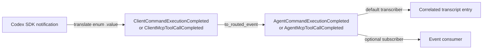
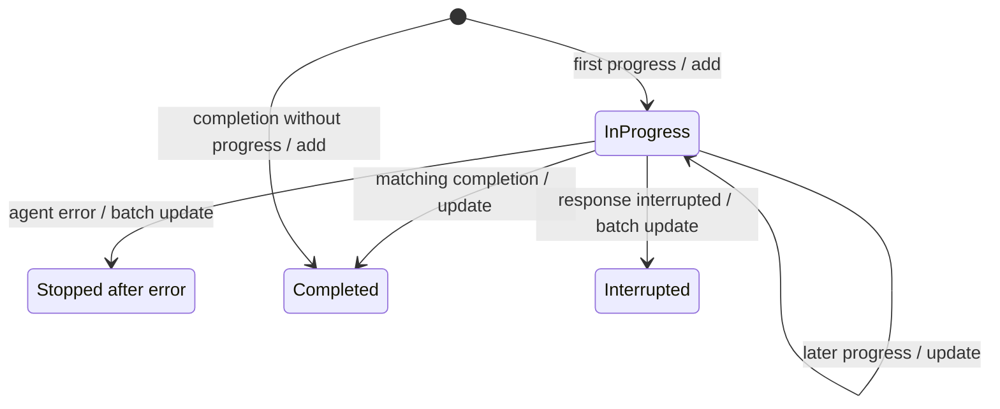

# Typed activity events

This page is for developers who consume Pairo events or extend transcript
rendering. It answers: **how do live command and MCP cards leave progress,
including on interruption or error, and which fields and status values remain
stable?**

## Provider-neutral completion contract

The Codex adapter converts supported SDK activities into typed client events at
the provider boundary. Routing adds the agent and session identity but preserves
the activity data. Event consumers therefore receive canonical status strings,
not generated SDK enums or strings such as
`CommandExecutionStatus.completed`.

The diagram shows where normalization occurs: before the client event is
published. Both routed-event subscribers and the default transcript UI see the
same provider-neutral values.

The completion contracts accept these exact values:

| Activity | Status values | Completion data |
| --- | --- | --- |
| Command execution | `inProgress`, `completed`, `failed`, `declined` | `activity_id`, `command`, optional `cwd`, optional `exit_code`, optional `output` |
| MCP tool call | `inProgress`, `completed`, `failed` | `activity_id`, `server`, `tool`, `arguments`, optional `result`, optional `error` |

Pydantic validation rejects values outside those sets. The public aliases are
`CommandExecutionCompletionStatus` and `McpToolCallCompletionStatus`; the
concrete client and routed event classes are exported from
`pairo.core.events`. `ClientActivityCompleted` and `AgentActivityCompleted`
remain abstract subscription bases when a consumer needs both activity
families.

Progress is also typed: command output arrives as
`ClientCommandExecutionProgress` / `AgentCommandExecutionProgress`, while MCP
progress arrives as `ClientMcpToolCallProgress` /
`AgentMcpToolCallProgress`.

## Live transcript lifecycle

The default registry subscribes to both progress families. A first progress
event creates a concise sourced card; later progress for the same activity
updates that durable entry instead of appending another row. Command progress
keeps only the latest output delta, because the completion event provides the
aggregated output. Empty command or MCP progress text renders a safe fallback.

The lifecycle is correlated by agent, session, activity family, and provider
activity ID. This prevents otherwise identical activity IDs from colliding
across agents, sessions, or command and MCP families. The derived entry key is
opaque: the raw provider ID is not displayed and is not stored in transcript
metadata.

`TranscriptService` asks the repository to atomically add or update the entry,
then publishes `TranscriptEntryAdded` or `TranscriptEntryUpdated` to match the
committed mutation. If persistence fails, it publishes neither notification.
The completion transcriber derives the same key, so it replaces the live card;
a completion received without progress creates the completed card directly.

When a routed response is interrupted, every still-pending command or MCP card
for that exact agent and session is atomically rewritten as an `Interrupted`
terminal card. When an `AgentError` arrives, its ordinary error transcript is
persisted first and those same pending cards are then rewritten as `Stopped
after error`. The rewrite preserves each card's entry key, position, family,
and latest bounded progress detail. It does not affect completed cards or any
other agent/session. Update notifications are emitted only after the batch
commit succeeds, so a failed persistence operation leaves both durable cards
and the live UI unchanged.

A normal `AgentResponseCompleted` does not infer an activity outcome. Pending
cards leave progress only through their matching activity completion, an
`AgentResponseInterrupted`, or an `AgentError`.

Unsupported provider activities still route as `AgentUnsupportedActivity` and
intentionally have no default transcript renderer.

## Transcript presentation

The default registry assigns dedicated transcribers to progress and completion
events. Progress cards use the shared sourced-text presentation. Completed
cards use a collapsed detail widget:

- A command title shows the human-readable outcome and the exit code when one
  is available. Expanding it reveals the full command, working directory, and
  output.
- An MCP title shows the server, tool, human-readable outcome, and error when
  one is available. Expanding it reveals the arguments, result, and error.

Both widgets start collapsed. Missing optional values render safe fallback
text or JSON `null`; SDK enum class names and provider bookkeeping do not
appear in their titles. The transcript continues to persist `agent` as its
source role, and rendering uses the configured agent display name for the
visible source heading.

## Compatibility boundary

The accepted values intentionally match the command and MCP statuses exposed
by the installed Codex SDK. If a future SDK adds a status, extend the
provider-neutral alias and its adapter mapping deliberately; otherwise event
validation will reject that new value. Other completed SDK item families
continue through the unsupported-activity route until Pairo defines a typed
contract and presentation for them.

## Live progress cadence

The UI persists the first command or MCP progress snapshot promptly.  Subsequent
snapshots for the same opaque correlated activity are coalesced to the latest
snapshot for a short internal cadence, avoiding one SQLite transaction and
transcript redraw per provider chunk. Completion, interruption, and errors
cancel pending work so a terminal card cannot be replaced by stale progress.
Application shutdown flushes retained snapshots before its owned repository
closes.
